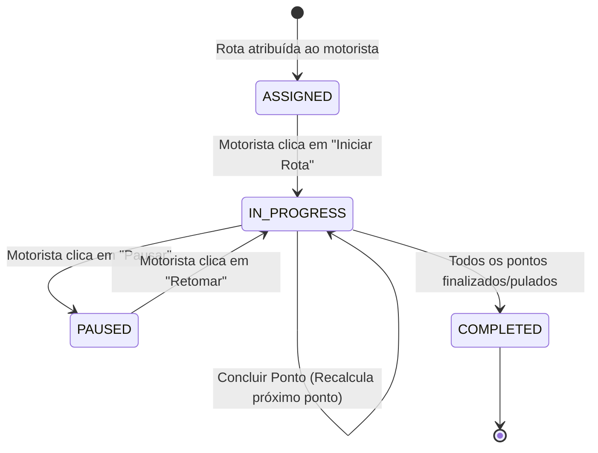
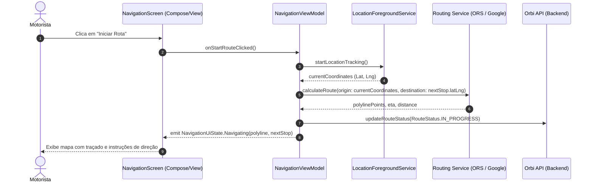

# Orbi App - Contexto do Projeto, Arquitetura e Regras de Negócio

Esta documentação serve como base de conhecimento técnica e arquitetural estática para o projeto **Orbi App**. Recorra a este documento sempre que precisar de contexto sobre o domínio, stack tecnológico, fluxo de navegação e integração com a **Orbi API**, evitando buscas redundantes ou suposições.

---

## 1. 🎯 Visão Geral do Domínio & Propósito
O **Orbi App** é um aplicativo móvel Android de navegação e execução logística em campo voltado para **motoristas e entregadores** da plataforma Orbi.

### Principais Objetivos:
1. **Autenticação e Carga de Rotas:** Autenticar o motorista e recuperar as rotas atribuídas especificamente a ele para o dia ou turno atual a partir da **Orbi API**.
2. **Visualização Ordenada das Paradas:** Listar todas as paradas/pontos de entrega (*waypoints*) na sequência pré-otimizada e ordenada definida pelo back-end.
3. **Navegação Inteligente Ponto a Ponto:** Ao selecionar ou iniciar uma rota, o app identifica a localização GPS atual do motorista e gera o traçado vetorial (rota/polyline) em direção à **próxima parada de entrega pendente**.
4. **Controle Operacional da Viagem:** Permitir ao motorista:
   - **Iniciar a Rota:** Inicia a telemetria, ativa o rastreamento em segundo plano e orienta o trajeto até a primeira parada pendente.
   - **Pausar a Rota:** Interrompe temporariamente a navegação e a alta precisão do GPS (para descanso, refeição ou abastecimento), notificando o servidor.
   - **Pular Endereço (Skip Stop):** Pula a parada atual (ex: cliente ausente, problema no local) registrando o motivo, e imediatamente recalcula a rota do ponto GPS atual até o próximo endereço da sequência.
   - **Concluir Entrega (Complete Stop):** Marca a entrega atual como concluída e guia o motorista até a parada subsequente.

---

## 2. 🛠 Stack Tecnológico Base
- **Plataforma:** Android Nativo
- **Linguagem Principal:** Kotlin (com interoperabilidade Java)
- **Versão do SDK Android:**
  - `minSdk`: 26 (Android 8.0 Oreo - garante suporte a serviços em primeiro plano e canais de notificação)
  - `targetSdk`: 37
  - `compileSdk`: 37
- **Arquitetura Base:** MVVM (Model-View-ViewModel) + Clean Architecture
- **Interface de Usuário (UI):**
  - Jetpack Compose (Modern Declarative UI) e/ou Android Views com ViewBinding & Material Components 3 (`com.google.android.material:material:1.14.0`)
- **Navegação & Mapas:**
  - Map SDK: Google Maps SDK for Android / MapLibre / OpenRouteService / OSRM API
  - GPS & Localização: Google Play Services Location (`FusedLocationProviderClient`)
- **Rede & Comunicação:**
  - HTTP / REST: Retrofit 2 + OkHttp 3 (com interceptor para token OAuth2 JWT)
  - Real-time / Telemetria: Spring WebSocket Client / STOMP ou SSE para envio contínuo da posição do veículo à Orbi API
- **Persistência Local (Offline-First):**
  - Banco de Dados: Room Database (SQLite) com suporte a `Flow` reativo
  - Preferências & Sessão: DataStore Preferences ou EncryptedSharedPreferences (para tokens e credenciais)
- **Injeção de Dependências:** Hilt (Dagger) ou Koin
- **Assincronismo:** Kotlin Coroutines & Flow (`StateFlow`, `SharedFlow`)

---

## 3. 🏗 Arquitetura do Projeto (Clean Architecture + MVVM)
O código é estruturado sob o pacote base `com.orbi.orbi_app`, dividido em camadas coesas e desacopladas:

```
com.orbi.orbi_app
├── data
│   ├── local
│   │   ├── dao             # DAOs do Room (RouteDao, WaypointDao)
│   │   ├── database        # Instância e migrações do OrbiDatabase
│   │   └── entity          # Entidades persistentes do Room
│   ├── remote
│   │   ├── api             # Interfaces Retrofit (OrbiApiService)
│   │   ├── dto             # Objetos de transferência de dados da API
│   │   └── websocket       # Cliente WebSocket para telemetria em tempo real
│   ├── repository          # Implementações concretas dos repositórios
│   └── service             # Foreground Service de rastreamento de localização
├── domain
│   ├── model               # Modelos de domínio puros (Route, Waypoint, DriverLocation)
│   ├── repository          # Interfaces abstratas dos repositórios
│   └── usecase             # Casos de uso de negócio (StartRoute, SkipWaypoint, etc.)
├── presentation
│   ├── auth                # Telas e ViewModels de login
│   ├── routes              # Listagem e detalhes das rotas do motorista
│   ├── navigation          # Tela do mapa, controles (Iniciar, Pausar, Pular) e turn-by-turn
│   └── common              # Componentes visuais compartilhados, temas e utilitários
└── di                      # Módulos de injeção de dependências (Hilt/Koin)
```

### Papel das Camadas:
* **`presentation` (UI & ViewModels):**
  - Captura eventos do motorista (cliques em "Iniciar", "Pausar", "Pular").
  - Consome `UiState` via `StateFlow` exposto pelos ViewModels (`RouteViewModel`, `NavigationViewModel`).
  - Renderiza o mapa, marcadores dos pontos, traçado da rota (Polyline) e status atual.
* **`domain` (Regras de Negócio e Casos de Uso):**
  - Isolada de frameworks Android. Contém UseCases específicos:
    - `GetAssignedRoutesUseCase`: Obtém as rotas atribuídas ao motorista logado.
    - `StartRouteUseCase`: Inicia a execução da rota e aciona o tracking.
    - `PauseRouteUseCase`: Pausa a rota e reduz telemetria.
    - `SkipWaypointUseCase`: Pula o endereço atual e comanda o recálculo do próximo destino.
    - `CalculatePathToNextStopUseCase`: Solicita o cálculo da rota entre a coordenada GPS atual e o próximo waypoint pendente.
* **`data` (Acesso a Dados & Integrações):**
  - Gerencia o cache local (Room) garantindo que, mesmo em áreas com sinal 3G/4G instável, o motorista tenha acesso aos endereços e informações da rota.
  - Implementa o `LocationForegroundService` para manter o rastreador GPS ativo enquanto o motorista está dirigindo, mesmo com a tela bloqueada ou app em segundo plano.

---

## 4. 🔄 Integração com a Orbi API (Back-End)
A **Orbi API** (Spring Boot 3.5.4, Java 21) é a autoridade central de dados. O **Orbi App** interage com os seguintes domínios do back-end:

| Domínio Orbi API | Endpoint / Ação no App | Descrição |
| :--- | :--- | :--- |
| **Auth** | `POST /api/auth/login` | Autentica o motorista, obtém JWT Token e dados do perfil (Role: `DRIVER`). |
| **Routes** | `GET /api/routes/assigned` | Retorna as rotas atribuídas ao motorista autenticado, contendo a lista ordenada de paradas. |
| **Route Status** | `PATCH /api/routes/{id}/status` | Atualiza o estado da rota geral (`IN_PROGRESS`, `PAUSED`, `COMPLETED`). |
| **Deliveries** | `PATCH /api/deliveries/{id}/status` | Atualiza a situação do ponto/entrega (`COMPLETED`, `SKIPPED`, com motivo). |
| **Telemetria** | WebSocket `/ws/driver-location` | Transmite latitude, longitude, velocidade e rumo do veículo em tempo real para rastreamento pela central. |

---

## 5. 📍 Fluxo Operacional de Navegação do Motorista

### 5.1. Inicialização e Carga de Rota
1. O motorista abre o app e se autentica.
2. O app consulta `GET /api/routes/assigned` e carrega as rotas designadas.
3. As paradas da rota são exibidas em ordem sequencial (`sequenceOrder: 1, 2, 3...`).
4. Ao selecionar a rota, o app identifica o primeiro ponto com status `PENDING`.

### 5.2. Iniciar Rota (Start Route)
1. O motorista clica no botão **"Iniciar Rota"**.
2. O app obtém a coordenada GPS imediata via `FusedLocationProviderClient`.
3. Inicia o serviço de localização em primeiro plano (`LocationForegroundService`) com notificação fixa na barra de status.
4. Gera e desenha a rota vetorial na tela: **(Posição Atual do Motorista) ➔ (Próxima Parada Pendente)**.
5. Notifica a Orbi API que a rota foi iniciada.

### 5.3. Pausar Rota (Pause Route)
1. O motorista clica em **"Pausar Rota"**.
2. O envio de alta precisão do GPS e o cálculo contínuo de rota são suspensos temporariamente.
3. A interface do mapa entra em estado de pausa, mantendo o último endereço visível.
4. Notifica a Orbi API sobre a pausa da rota.

### 5.4. Pular Endereço (Skip Stop)
1. Se o motorista não puder atender o endereço atual, clica em **"Pular Endereço"**.
2. O app exibe um diálogo solicitando o motivo (ex: "Destinatário Ausente", "Endereço Não Localizado", "Via Bloqueada").
3. O ponto atual tem seu status alterado para `SKIPPED`.
4. O app busca o próximo ponto da lista (`sequenceOrder` seguinte) cujo status seja `PENDING`.
5. Obtém a localização GPS atual do motorista e **recalcula a rota imediatamente até o novo ponto de parada**.
6. Sincroniza a alteração com a Orbi API.

---

## 6. 📊 Diagramas de Fluxo e Estados

### Máquina de Estados da Rota:


### Fluxo de Sequência da Navegação:


---

## 7. ⚠️ Diretrizes e Padrões Obrigatórios para IAs Codificadoras
1. **Permissões em Runtime:** Nunca inicie o rastreamento sem verificar e solicitar as permissões de `ACCESS_FINE_LOCATION`, `ACCESS_COARSE_LOCATION` e `POST_NOTIFICATIONS` (Android 13+).
2. **Respeito à Bateria:** Nunca deixe o `FusedLocationProviderClient` solicitando alta precisão se o motorista estiver com a rota pausada ou concluída.
3. **Resiliência Offline:** Todas as rotas e paradas recebidas devem ser cacheadas no Room para permitir que o motorista visualize os endereços mesmo se o sinal de celular falhar durante o percurso.
4. **Isolamento de DTOs:** Não use DTOs de rede diretamente na interface gráfica. Mapeie `RouteDto` para o modelo de domínio `Route` antes de entregar ao ViewModel.
5. **Segurança de Sessão:** Armazene tokens de autenticação exclusivamente em locais seguros (`EncryptedSharedPreferences` ou Jetpack DataStore com criptografia).
