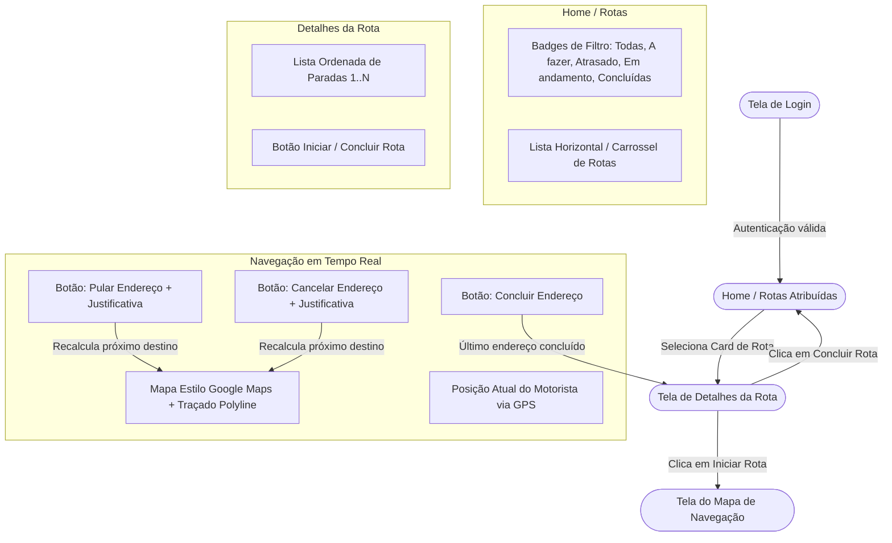
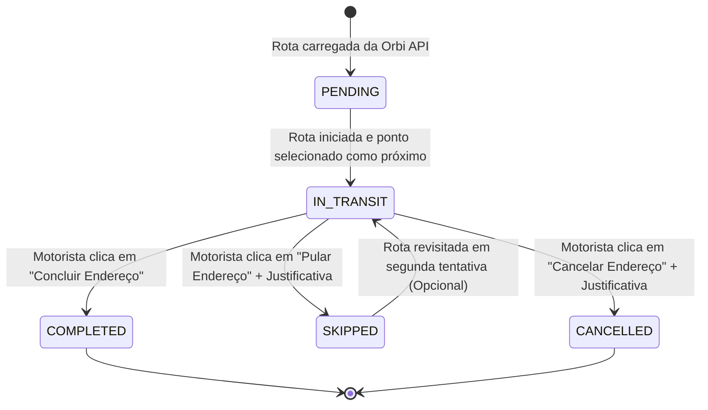

# Especificação Técnica e Levantamento de Requisitos - Orbi App (Android)

**Projeto:** Orbi App (Navegação e Execução Logística)  
**Público-Alvo:** Motoristas e Entregadores  
**Autor:** Engenheiro de Software Mobile / Arquiteto Android  
**Status:** Aprovado para Desenvolvimento  
**Versão:** 1.0  

---

## 1. 🎯 Visão Geral & Objetivos de Negócio

O **Orbi App** é a aplicação Android nativa responsável por conectar o motorista em campo à operação logística da plataforma Orbi. O aplicativo deve proporcionar uma experiência de condução fluida, segura e com o mínimo de distrações visuais, permitindo ao motorista:
1. Autenticar-se de forma segura e manter a sessão ativa.
2. Visualizar suas rotas de entrega diárias organizadas em uma listagem horizontal contínua com filtros rápidos de status.
3. Acessar os detalhes de uma rota e conferir a lista de paradas ordenadas de forma otimizada.
4. Executar a rota através de um mapa de navegação em tempo real minimalista, com traçado vetorial (estilo Google Maps) e controles simplificados para **Concluir**, **Pular** e **Cancelar** paradas com registro de justificativas.

---

## 2. 🗺️ Fluxo de Navegação e Arquitetura Visual



---

## 3. 📋 Requisitos Funcionais (RF)

### 3.1. Módulo 1: Autenticação (Tela de Login)

- **[RF-01] Autenticação de Motorista:** O app deve permitir que o motorista faça login fornecendo suas credenciais (E-mail/Matrícula e Senha).
- **[RF-02] Validação Prévia de Campos:** Os campos de entrada devem validar formatação de e-mail e preenchimento obrigatório antes do disparo de rede.
- **[RF-03] Armazenamento Seguro de Sessão:** Ao autenticar com sucesso via Orbi API (OAuth2 JWT), o `access_token` e `refresh_token` devem ser persistidos em armazenamento criptografado (`EncryptedSharedPreferences` ou DataStore com Jetpack Security).
- **[RF-04] Auto-Login e Restauração de Sessão:** Ao iniciar o aplicativo, se houver um token válido armazenado, o app deve redirecionar diretamente para a tela de **Home / Rotas** sem exigir novas credenciais.
- **[RF-05] Tratamento de Erros de Login:** Exibir mensagens amigáveis em caso de credenciais inválidas (HTTP 401), usuário bloqueado ou ausência de conexão à internet.
- **[RF-06] Logout:** Disponibilizar opção de encerramento de sessão, que limpa os tokens locais e os dados em cache, redirecionando para o Login.

---

### 3.2. Módulo 2: Rotas / Home (Lista Horizontal Infinita e Filtros)

- **[RF-07] Consulta de Rotas Atribuídas:** O app deve requisitar à Orbi API (`GET /api/routes/assigned`) todas as rotas vinculadas ao motorista logado.
- **[RF-08] Exibição em Carrossel Horizontal:** As rotas devem ser exibidas em uma lista horizontal de rolagem contínua/infinita (Horizontal Pager / Snap RecyclerView), onde cada item é um card visual contendo:
  - Identificador/Código da Rota.
  - Quantidade total de paradas e paradas restantes.
  - Estimativa de horário/tempo total.
  - Badge colorido com o status atual da rota.
- **[RF-09] Filtros Flutuantes por Badges/Chips:** A tela deve apresentar no topo, de forma fixa/flutuante, chips de filtro com os estados:
  - `Todas`
  - `A fazer` (Pending/Assigned)
  - `Atrasado` (Delayed)
  - `Em andamento` (In Progress)
  - `Concluídas` (Completed)
- **[RF-10] Regra de Exibição das Rotas Concluídas:**
  - Por padrão, rotas com status `Concluídas` **NÃO** devem ser exibidas na listagem inicial.
  - Rotas concluídas devem ser carregadas e visíveis **exclusivamente** quando o usuário selecionar explicitamente o badge **"Concluídas"**.
- **[RF-11] Pull-to-Refresh:** O motorista deve ser capaz de puxar a lista para atualizar os dados diretamente da API.
- **[RF-12] Navegação para Detalhes:** Ao tocar em qualquer card de rota, o aplicativo deve abrir a **Tela de Detalhes da Rota** correspondente.

---

### 3.3. Módulo 3: Detalhes da Rota (Lista de Paradas e Ação Principal)

- **[RF-13] Listagem Ordenada de Paradas:** A tela deve exibir todos os pontos de entrega (*waypoints*) na ordem estrita de entrega (`sequenceOrder: 1, 2, 3...`) determinada pelo algoritmo de otimização da Orbi API.
- **[RF-14] Detalhes do Card de Parada:** Cada item da lista deve exibir:
  - Número da sequência de parada (Ex: `#01`, `#02`).
  - Endereço completo (Rua, Número, Bairro, Cidade).
  - Nome do destinatário e telefone/documento para contato.
  - Status do endereço (`Pendente`, `Em Trânsito`, `Concluído`, `Pulado`, `Cancelado`).
- **[RF-15] Botão de Ação Dinâmica (Iniciar / Concluir):**
  - **Estado "Iniciar Rota":** Exibido se a rota estiver com status `A fazer` ou `Pausada`. Ao ser clicado:
    1. Atualiza o status da rota para `Em andamento` na API.
    2. Identifica o primeiro endereço pendente.
    3. Abre imediatamente a tela do **Mapa de Navegação em Tempo Real**.
  - **Estado "Concluir Rota":** Fica habilitado ou alternado quando todas as paradas da rota estiverem com status terminal (`Concluído`, `Cancelado` ou `Pulado`). Ao ser clicado:
    1. Envia requisição de finalização para a Orbi API (`PATCH /api/routes/{id}/status` -> `COMPLETED`).
    2. Atualiza os registros locais no banco Room.
    3. Redireciona o motorista de volta para a tela de **Rotas/Home**.

---

### 3.4. Módulo 4: Mapa de Navegação em Tempo Real & Controles

- **[RF-16] Interface Minimalista e Limpa:** O mapa deve priorizar a visão desimpedida das vias, ocultando elementos desnecessários da interface e mantendo apenas:
  - Traçado da rota (Polyline).
  - Marcador da posição atual do motorista (ícone direcional com rumo/bearing).
  - Marcador da próxima parada de entrega.
  - Painel superior compacto com nome da rua da próxima parada e distância/tempo estimado (ETA).
  - Barra de ações inferior flutuante com poucos botões.
- **[RF-17] Renderização do Traçado da Rota:** O app deve traçar a rota vetorial em tempo real da **posição GPS atual do motorista** até o **próximo endereço pendente na ordem da rota**.
- **[RF-18] Câmera Dinâmica em Tempo Real:** O mapa deve centralizar e acompanhar suavemente a posição do veículo, rotacionando de acordo com o rumo (*bearing*) do deslocamento do motorista (estilo Google Maps Navigation).
- **[RF-19] Botão "Concluir Endereço":**
  - Ao chegar ao destino e efetuar a entrega, o motorista clica em "Concluir Endereço".
  - O app marca o status da parada atual como `COMPLETED` localmente e na Orbi API.
  - Verifica se há paradas pendentes subsequentes:
    - Se houver: identifica a próxima parada (`sequenceOrder + 1`), recalcula a rota imediatamente a partir da posição GPS atual e atualiza a tela do mapa.
    - Se for a última parada: abre confirmação para encerramento da rota e retorno à tela de Detalhes ou Home.
- **[RF-20] Botão "Pular Endereço" (Com Justificativa):**
  - Ao clicar em "Pular Endereço", um modal/bottom sheet deve ser aberto solicitando a seleção obrigatória de uma justificativa (ex: *Destinatário Ausente*, *Horário Comercial Fechado*, *Via Bloqueada/Obras*, *Outro*).
  - O status da parada é atualizado para `SKIPPED` na Orbi API e no Room.
  - O mapa recalcula a rota do ponto GPS atual diretamente para a próxima parada pendente da sequência.
- **[RF-21] Botão "Cancelar Endereço" (Com Justificativa):**
  - Ao clicar em "Cancelar Endereço", um modal/bottom sheet deve exigir a seleção/preenchimento do motivo de cancelamento definitivo (ex: *Cancelado pelo Cliente*, *Endereço Inexistente*, *Carga Avariada*).
  - O status da entrega é alterado para `CANCELLED` na Orbi API e no Room.
  - O mapa recalcula a rota para a parada seguinte.
- **[RF-22] Rastreamento em Segundo Plano (Foreground Service):** A navegação e o tracking GPS devem permanecer operantes mesmo com o app minimizado ou tela bloqueada, através de um `Foreground Service` com notificação persistente.

---

## 4. ⚡ Requisitos Não-Funcionais (RNF)

- **[RNF-01] Compatibilidade de Plataforma:** Suporte a partir do Android 8.0 (API level 26) até o Android 15/16 (API level 37).
- **[RNF-02] Otimização de Bateria:** Utilizar `LocationRequest` com intervalos inteligentes (ex: 2 a 5 segundos durante navegação ativa; desativação imediata ao pausar ou concluir a rota).
- **[RNF-03] Latência de Recálculo de Rota:** O recálculo de rota após o clique em "Pular", "Cancelar" ou desvio de itinerário deve responder em menos de 1,5 segundos sob conexão de rede estável.
- **[RNF-04] Resiliência Offline (Offline-First):** As rotas atribuídas, dados dos endereços e justificativas preenchidas devem ser armazenados localmente no banco SQLite/Room. Caso a conexão 4G/5G caia, o motorista continua visualizando a lista de endereços e o app enfileira as requisições de status para sincronização posterior (WorkManager).
- **[RNF-05] Usabilidade com Uma Mão / Direção Segura:** Botões de ação do mapa devem possuir alvos de toque grandes (mínimo de 48x48 dp, recomendado 56 dp) e contraste alto de acordo com as diretrizes do Material Design 3.
- **[RNF-06] Segurança de Dados:** Nenhuma credencial ou token deve ser gravado em texto puro. Toda comunicação com a Orbi API deve utilizar HTTPS/WSS com TLS 1.3.

---

## 5. 🧪 Critérios de Aceite (Gherkin / Given-When-Then)

### Cenário 1: Comportamento do filtro de rotas concluídas na Home
```gherkin
Funcionalidade: Filtro de rotas concluídas
  Como um motorista da Orbi
  Eu quero que as rotas concluídas fiquem ocultas por padrão
  Para focar exclusivamente nas entregas pendentes do meu dia

  Cenário: Visualização padrão ao abrir a Home
    Dado que o motorista efetuou login com sucesso
    E existem rotas com status "A fazer", "Em andamento" e "Concluídas"
    Quando a tela de Rotas/Home é carregada
    Então os cards de rotas "A fazer" e "Em andamento" são exibidos no carrossel
    Mas os cards de rotas "Concluídas" não devem ser exibidos

  Cenário: Seleção do badge "Concluídas"
    Dado que o motorista está na tela de Rotas/Home
    Quando ele clica no badge de filtro "Concluídas"
    Então o carrossel é filtrado exibindo exclusivamente as rotas com status "Concluídas"
```

### Cenário 2: Início da rota e traçado no mapa
```gherkin
Funcionalidade: Iniciar rota e traçar trajeto inicial
  Como um motorista
  Eu quero que o app trace automaticamente o caminho até a próxima parada
  Para que eu possa dirigir sem precisar digitar endereços manualmente

  Cenário: Iniciar rota com paradas pendentes
    Dado que o motorista selecionou uma rota na Home
    E a tela de Detalhes da Rota exibe a parada 1 e a parada 2 como pendentes
    Quando o motorista clica no botão "Iniciar Rota"
    Então a Orbi API recebe a atualização da rota para o status "IN_PROGRESS"
    E a tela do Mapa de Navegação em Tempo Real é aberta
    E o mapa traça a rota da coordenada GPS atual do motorista até o endereço da parada 1
```

### Cenário 3: Pular endereço com justificativa
```gherkin
Funcionalidade: Pular endereço de entrega
  Como um motorista em trânsito
  Eu quero pular um endereço que não pôde ser atendido no momento
  Para continuar as entregas sem travar a sequência da rota

  Cenário: Motorista pula a parada atual informando motivo
    Dado que o motorista está navegando em direção à parada 2
    Quando ele toca no botão "Pular Endereço"
    Então um diálogo de justificativa é exibido na tela
    Quando ele seleciona o motivo "Destinatário Ausente" e confirma
    Então a parada 2 é marcada com o status "SKIPPED"
    E a Orbi API é notificada com o status e a justificativa
    E o mapa recalcula imediatamente a rota da posição atual até a parada 3
```

### Cenário 4: Cancelar endereço com justificativa
```gherkin
Funcionalidade: Cancelar endereço de entrega
  Como um motorista
  Eu quero cancelar definitivamente uma entrega inviável
  Para registrar a falha operacional no sistema com o motivo correto

  Cenário: Motorista cancela a entrega por endereço incorreto
    Dado que o motorista está navegando para a parada 3
    Quando ele clica em "Cancelar Endereço"
    E escolhe a justificativa "Endereço Inexistente" e confirma
    Então a parada 3 tem seu status alterado para "CANCELLED"
    E a Orbi API registra o cancelamento da entrega com o motivo
    E o mapa remove a parada 3 e traça a rota para a parada 4
```

### Cenário 5: Conclusão da rota
```gherkin
Funcionalidade: Conclusão total da rota
  Como um motorista
  Eu quero finalizar a rota após tratar todas as paradas
  Para registrar o encerramento do meu turno de entregas

  Cenário: Concluir última parada e finalizar rota
    Dado que o motorista concluiu a última parada restante da rota
    Quando a tela de Detalhes da Rota é reaberta
    Então o botão de ação principal exibe "Concluir Rota"
    Quando o motorista clica em "Concluir Rota"
    Então o status da rota é atualizado para "COMPLETED" na Orbi API
    E o motorista é redirecionado para a tela de Rotas/Home
```

---

## 6. ⚠️ Mapeamento de Casos de Borda (Edge Cases)

| Caso de Borda | Impacto Potencial | Tratamento e Mitigação Recomendados |
| :--- | :--- | :--- |
| **Perda de Sinal de GPS (ex: Túnel / Subsolo)** | Interrupção da navegação e travamento da câmera do mapa. | O app deve manter na tela a última posição conhecida com indicador visual de "Buscando sinal GPS..." e continuar exibindo o traçado salvo em cache. |
| **Queda de Conexão 4G/5G durante ação** | Falha ao enviar atualização de "Concluir/Pular" para a Orbi API. | A alteração de status e a justificativa são salvas imediatamente no banco local (Room) com flag `syncPending = true`. Um worker em background (`WorkManager`) sincroniza assim que a internet retornar. |
| **Pular o último ponto restante da rota** | O motorista não tem mais paradas subsequentes para traçar rota. | O app detecta que não há novas paradas com status `PENDING`, informa que todas as paradas foram tratadas e oferece botão para finalizar a rota. |
| **Permissão de Localização negada em tempo de execução** | Impossibilidade de calcular a rota de origem. | O app intercepta a ausência de permissão e abre um diálogo explicativo solicitando a concessão de `ACCESS_FINE_LOCATION`, orientando a ativação nas configurações do Android caso tenha sido negada permanentemente. |
| **Motorista desvia significativamente do traçado** | Orientações de direção desatualizadas. | O algoritmo do mapa monitora a distância do veículo em relação à Polyline ativa. Se ultrapassar tolerância (ex: > 35 metros), dispara recálculo automático silencioso. |

---

## 7. 🗄️ Estrutura de Modelos de Dados (Mobile)

### Entidade `Route` (Local e Domínio)
```kotlin
data class Route(
    val id: String,
    val code: String,
    val driverId: String,
    val status: RouteStatus, // ASSIGNED, IN_PROGRESS, DELAYED, PAUSED, COMPLETED
    val totalWaypoints: Int,
    val completedWaypoints: Int,
    val estimatedDurationMinutes: Int,
    val waypoints: List<Waypoint>
)
```

### Entidade `Waypoint` (Parada / Ponto de Entrega)
```kotlin
data class Waypoint(
    val id: String,
    val routeId: String,
    val sequenceOrder: Int,
    val recipientName: String,
    val recipientPhone: String,
    val addressStreet: String,
    val addressNumber: String,
    val neighborhood: String,
    val city: String,
    val latitude: Double,
    val longitude: Double,
    val status: WaypointStatus, // PENDING, IN_TRANSIT, COMPLETED, SKIPPED, CANCELLED
    val justification: String? = null,
    val completedAt: Long? = null
)
```

### Contrato de Justificativa para Pular ou Cancelar
```kotlin
data class DeliveryActionPayload(
    val waypointId: String,
    val action: DeliveryActionType, // SKIP ou CANCEL
    val reason: String,
    val driverLatitude: Double,
    val driverLongitude: Double,
    val timestamp: Long = System.currentTimeMillis()
)
```

---

## 8. 🔄 Diagrama de Estados do Ponto de Entrega (Waypoint)


